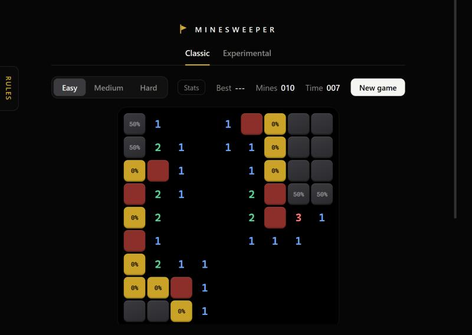

# Minesweeper

A minesweeper for the browser that can teach you how to solve it. A built-in solver shows which tiles are certain mines, which are certain safe and how likely the rest are, one rule at a time, and it can play the moves for you. One HTML file, no build step, no dependencies.

## Play

**[Play in your browser](https://cubicobelus.github.io/minesweeper/)**

## The game

- Three sizes: Easy 9x9 with 10 mines, Medium 16x16 with 40, Hard 30x16 with 99.
- The first click is always safe.
- Timer, mine counter, a best time per size and a stats popup (wins, win rate, average time, streaks).
- Two tabs on the same board. Classic shows normal numbers. Experimental subtracts one from every number around a flag, so a 0 means that number is finished.
- Clearing ripples outward, a win sends a gold wave across the board, a loss shakes it.

## Controls

| Action | Mouse | Touch |
| --- | --- | --- |
| Dig | Click | Tap (Dig mode) |
| Flag | Right-click | Tap (Flag mode) or long-press |
| Clear around a finished number | Middle-click, or click the number | Tap the number |
| Highlight around a tile | Hold the middle button | |
| New game | `R` or the New game button | New game button |

On a phone a Dig / Flag switch appears under the board so you can choose what a tap does.

## Learn the rules

Open the **Rules** tab on the left edge. Each rule is a box you can switch on or off, and every box has a short "How it works" with a picture. Everything is off to start, so you can try to spot things yourself first. With a rule on, certain mines turn red and certain safe tiles turn gold with a tick. Hover a marked tile to see which rule proved it, and the numbers it used are ringed.

| Rule | What it says |
| --- | --- |
| 1 Full count | A number whose closed tiles equal the number: all mines. |
| 2 Satisfied | A number that already has its mines: the other closed tiles are safe. |
| 3 Subset | One number's tiles sit inside another's, so the leftover tiles hold the difference (the 1-2 pattern). |
| 4 Overlap | Two numbers share tiles and one needs as many more mines as it has tiles of its own. |
| 5 Mine count | The mines left equal the unknown tiles, or none are left. |
| 6 Every layout | List every arrangement that fits the numbers and the total. Always a mine means certain, never a mine means safe. |
| 7 Chances | Tiles next to a number show their chance of being a mine. Safe tiles show 0%. |

With rules 1 to 6 on you see every tile that can be known from the board. The **All** box switches everything on or off at once.

## Let it play

Below the rules are options that make the board play itself, all off by default:

- **Hover chord**: hovering a finished number clears around it, as if the middle button were held.
- **Auto chord**: every number whose flags match it is cleared without hovering.
- **Auto flag**: flags every red mine.
- **Auto open**: opens every certain safe tile.
- **Delay**: from instant, through 10 ms, up to 1 second between moves, so you can watch it work.

Wrong flags are never undone, and a wrong flag can still set off a mine when chording.

## How the solver works

Every opened number says its closed neighbours hold exactly that many mines. Rules 1 to 5 reason about those statements directly. Rule 6 splits the board into groups of linked tiles, lists every layout of mines for each group, and combines the groups with the total mine count. Chances are the share of all valid layouts in which a tile is a mine. Flags are ignored, so a wrong flag cannot mislead it. A very tangled group stops after 250,000 steps and the panel says so. During development the results were checked against brute-force enumeration on small boards.

## Run locally

Open `index.html` in any browser. Settings, best times and stats are kept in the browser's local storage and are never sent anywhere.

## License

MIT. See [LICENSE](LICENSE).
